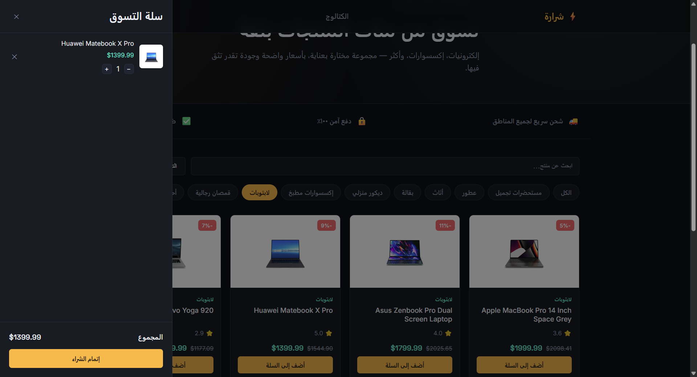

<<<<<<< HEAD
# ⚡ Sharara Store

**Sharara** is a responsive Arabic e-commerce store built with HTML, CSS, and Vanilla JavaScript.

The project demonstrates product browsing, search, category filtering, sorting, and shopping cart management.

## Features

- Product fetching using DummyJSON API.
- Dynamic product rendering.
- Search products by name.
- Filter products by category.
- Sort products by price and rating.
- Add and remove products from the cart.
- Increase and decrease product quantities.
- Automatic cart total calculation.
- Persist cart data using LocalStorage.
- Responsive user interface.
- Arabic RTL layout.

## Technologies Used

- HTML5
- CSS3
- JavaScript (Vanilla JS)
- Fetch API
- Async/Await
- LocalStorage
- DummyJSON API

## Project Structure

```text
sharara-store/
├── index.html
├── style.css
├── script.js
├── .gitignore
└── README.md
```

## Getting Started

1. Clone the repository:

```bash
git clone YOUR_REPOSITORY_URL
```

2. Open the project folder.

3. Open `index.html` in your browser.

No installation or build process is required.

## API

Product data is provided by [DummyJSON](https://dummyjson.com/products).

## Project Status

This is a learning project built to practice frontend development and JavaScript.

## Author

**Abderrahim Bennacer**

## License

This project is available for educational purposes.

## Screenshots

### Homepage


### Products


### Shopping Cart


=======
# sharara-store
A responsive Arabic e-commerce store built with HTML, CSS, and Vanilla JavaScript, featuring product search, category filtering, sorting, and shopping cart management with LocalStorage.
>>>>>>> 66d977f62c56bd34b0aa54b032a918690d9947d6
